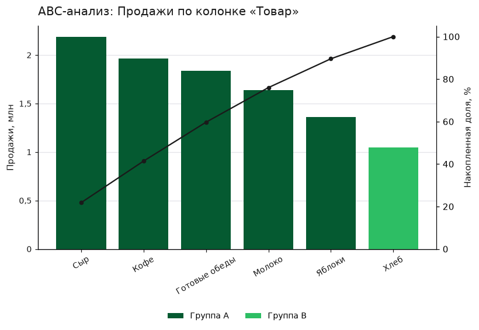
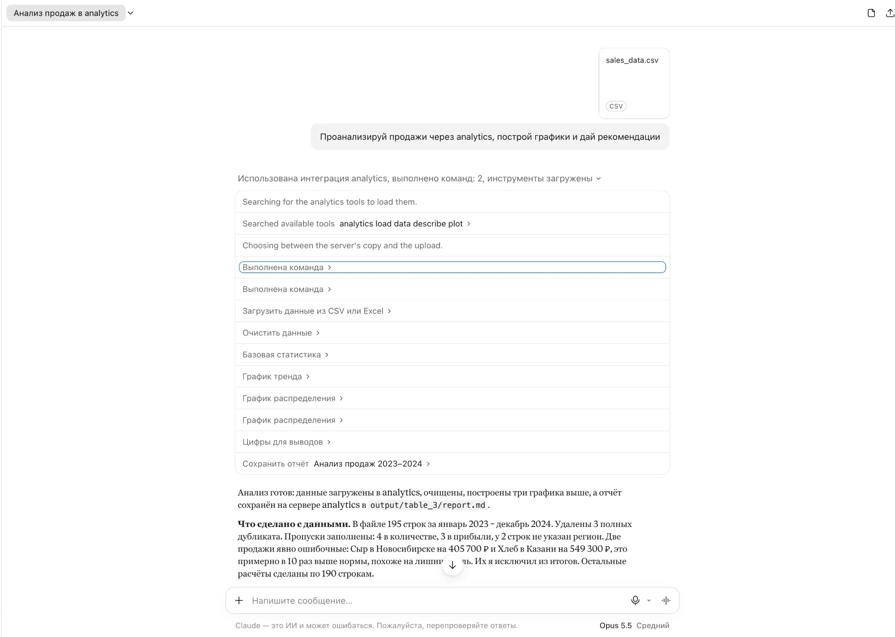

# MCP-сервер для анализа таблиц

Сервер по протоколу MCP. По запросу в чате он загружает CSV или Excel, чистит данные, строит графики и собирает отчёт с выводами и рекомендациями. Тестовое задание: MCP-сервер и скиллы для анализа данных.

Запрос из задания «Проанализируй продажи из файла sales_data.csv, построй графики и дай рекомендации» проходит в четырёх клиентах: Claude Desktop, claude.ai, консольный клиент на OpenRouter и Telegram-бот. Сервер во всех четырёх один.

## Как попробовать без установки

Напишите в Telegram боту [@test_vkusvillmcpKK_bot](https://t.me/test_vkusvillmcpKK_bot). Пришлите ему CSV или Excel, запрос напишите в подписи к файлу. Примерно через минуту придут альбом графиков, текст выводов и отчёт в PDF. Для пробы подойдут оба файла из папки `data/`.

Бот работает на моём сервере. Под ним те же MCP-сервер и клиент, что лежат в этом репозитории. Файл и запрос уходят провайдеру языковой модели через OpenRouter, поэтому данные, которые нельзя показывать, присылать не стоит. Сообщения бот обрабатывает по одному.

Тот же сервер подключается к claude.ai, тоже без установки:

1. В claude.ai откройте Settings → Connectors → Add custom connector.
2. Впишите адрес `https://affluent-grant-finalize.ngrok-free.dev/mcp` и выберите вход «No sign in».
3. В новом чате напишите: «Проанализируй продажи из файла sales_data.csv, построй графики и дай рекомендации». Прикладывать файл не нужно: на сервере лежат оба файла из папки `data/`.

Адрес идёт через бесплатный туннель ngrok. Ссылку на PDF отчёта браузер открывает через страницу-предупреждение ngrok с кнопкой Visit Site. Авторизации у адреса нет, сервер читает только свою папку `data/`. Адрес я проверил 11 ноября 2026 своим MCP-клиентом: цепочка дошла до отчёта, PDF по ссылке открылся. Запрос из claude.ai через этот адрес я не проверял; через туннель Cloudflare с ноутбука он проходил.

## Что работает и что нет

Работает:

- 11 инструментов в пяти скиллах: загрузка, очистка, графики, ABC-анализ, выводы. Четыре скилла из задания, пятый добавлен после готового ядра одним файлом.
- Два транспорта: stdio для локальных клиентов и Streamable HTTP для claude.ai.
- Порядок этапов задаёт сервер. Каждый ответ инструмента называет следующий шаг в поле `next_step`.
- Отчёт в двух видах: Markdown и PDF одним файлом с графиками внутри.
- Чужой файл: Excel с шапкой над таблицей, разделитель `;`, кодировка Windows-1251, даты в русском и американском порядке, строки «Итого».
- 38 тестов проходят, `flake8` не находит замечаний (запуск 11 ноября 2026, Python 3.12.4, macOS).

Не работает или не проверено:

- В обычном чате Claude Desktop графики видны только в раскрытом блоке вызова инструмента. Во вкладке Code и в claude.ai они видны в ответе.
- Файл, прикреплённый к чату Claude без упоминания сервера, Claude разбирает своим встроенным анализом, сервер не вызывается.
- У адреса HTTP нет авторизации. Это режим для показа через временный туннель.
- Windows, настоящий Superstore с Kaggle и ChatGPT с этим сервером я не проверял. На Linux проверены запуск сервера и бота, тесты там не запускались.

Полный список стоит в разделе «Что я знаю об ограничениях».

## Как установить и проверить

Нужен Python 3.11 или новее: этого требует pandas 3.

```bash
python3 -m venv .venv
```

```bash
.venv/bin/pip install -r requirements-dev.txt
```

```bash
.venv/bin/python -m pytest -q
```

Последняя команда должна напечатать `38 passed`. На Windows вместо `.venv/bin/` пишется `.venv\Scripts\`.

Установку с нуля я проверил сам 11 ноября 2026: выгрузил последний коммит в пустую папку, создал новое окружение этими командами, тесты прошли. На чужой машине установку не проверял.

## Как подключить к клиенту

### Claude Desktop

1. Закройте Claude Desktop полностью (на macOS: Cmd+Q). Приложение перезаписывает свой конфиг, пока работает, и правка при открытом приложении пропадает.
2. Откройте `claude_desktop_config.json`. На macOS он лежит в `~/Library/Application Support/Claude/`, на Windows в `%APPDATA%\Claude\`.
3. Добавьте сервер и подставьте полные пути к папке репозитория:

```json
{
  "mcpServers": {
    "analytics": {
      "command": "/полный/путь/к/репозиторию/.venv/bin/python",
      "args": ["/полный/путь/к/репозиторию/server.py"],
      "env": {"ANALYTICS_OPEN_REPORT": "1"}
    }
  }
}
```

4. Откройте Claude Desktop и напишите: «Проанализируй продажи из файла sales_data.csv, построй графики и дай рекомендации». Файл к чату прикладывать не нужно: сервер читает его из своей папки `data/`.

Строка `env` необязательна. С ней сервер сам открывает готовый PDF в конце анализа.

Приложение спросит разрешение на каждый инструмент. Чтобы не подтверждать одиннадцать раз, выберите «Всегда разрешать» в настройках коннектора.

### claude.ai

Веб-клиент ходит к серверу по HTTP, поэтому серверу нужен публичный адрес. Я брал быстрый туннель Cloudflare: он работает без аккаунта.

```bash
cloudflared tunnel --no-autoupdate --url http://127.0.0.1:8000
```

Туннель напечатает адрес вида `https://имя.trycloudflare.com`. Во втором окне терминала запустите сервер и передайте ему это имя:

```bash
.venv/bin/python server.py --http --port 8000 --public-host имя.trycloudflare.com
```

В claude.ai: Settings → Connectors → Add custom connector, адрес `https://имя.trycloudflare.com/mcp`, вход «No sign in». Дальше тот же запрос в новом чате. В конце ответа будет ссылка на PDF отчёта.

Без `--public-host` сервер отвечает 421 на запрос через туннель: он принимает только свой адрес. Имя туннеля меняется при каждом запуске, коннектор приходится добавлять заново.

### Консольный клиент

Вариант «через API» из задания. Клиент подключается к тому же серверу как MCP-клиент и ведёт цикл вызова инструментов через OpenRouter.

```bash
cp .env.example .env
```

Впишите в `.env` ключ `OPENROUTER_API_KEY`. Модель по умолчанию `deepseek/deepseek-v4.1-flash`, другая задаётся в `OPENROUTER_MODEL`.

```bash
.venv/bin/python clients/console_client.py --file data/sales_data.csv "Проанализируй продажи, построй графики и дай рекомендации"
```

Графики, отчёт и журнал вызовов ложатся в `output/<дата_время>/`.

<details>
<summary>Свой Telegram-бот</summary>

Готовый бот указан в начале README. Чтобы запустить своего, создайте бота у `@BotFather`, впишите токен в `.env` как `TELEGRAM_BOT_TOKEN` и запустите:

```bash
.venv/bin/python clients/telegram_bot.py
```

Пришлите боту CSV или Excel, запрос напишите в подписи к файлу. В ответ придут альбом графиков, текст выводов и `report.pdf`. Бот опрашивает Telegram сам, публичный адрес ему не нужен. Файл и запрос уходят провайдеру языковой модели.

Список разрешённых чатов задаётся в `TELEGRAM_ALLOWED_CHATS`. Пустой список значит, что бот отвечает всем.

</details>

### Как файл попадает на сервер

| Откуда файл | Что написать |
|---|---|
| Лежит в папке `data/` сервера | Назвать файл по имени: «…из файла sales_data.csv» |
| Лежит в другом месте на этой машине | Дать полный путь. Работает только локально: по HTTP и под ботом сервер читает одну папку `data/` |
| Прикреплён к чату Claude | Назвать сервер в запросе: «…через analytics…». Тогда Claude передаёт текст таблицы в аргументе `csv_text`, до 300 000 символов. Проверено на CSV, вложение Excel не проверял |
| Прислан боту в Telegram | Бот сам сохраняет файл в `data/uploads/` |

## Что получается на выходе

Запуск консольного клиента на `data/sales_data.csv`, 11 ноября 2026. Модель сделала 11 вызовов за 8 запросов, запуск стоил 0,006 доллара (журнал `examples/console/console-log.txt`):

```
load_data → describe_data → clean_data → suggest_charts
→ plot_trend → plot_distribution → plot_distribution → correlation_analysis
→ collect_findings → abc_analysis → save_report
```

Очистка в этом запуске: удалено 3 дубликата, заполнено 9 пропусков, 2 продажи с лишним нулём исключены из расчётов.




Отчёт целиком: [report.md](examples/report-sales/report.md) и [report.pdf](examples/report-sales/report.pdf). Отчёт по «грязной» выгрузке Excel: [report.md](examples/report-orders/report.md). Остальные материалы описаны в [examples/README.md](examples/README.md).

В данные `sales_data.csv` я заложил три закономерности: декабрьский пик, рост Казани и убыточные «Готовые обеды». Отчёт считаю осмысленным, если он назвал две из трёх. В этом запуске названы все три.

## Какие инструменты видит модель

| Инструмент | Аргументы | Что делает |
|---|---|---|
| `list_data_files` | | Показывает файлы в папке `data/` |
| `load_data` | `file_path?`, `sheet?`, `csv_text?` | Читает CSV или Excel, определяет типы колонок, возвращает `dataset_id` и порядок анализа |
| `describe_data` | `dataset_id` | Считает базовую статистику, пропуски и дубликаты |
| `clean_data` | `dataset_id`, `drop_duplicates?`, `fill_missing?`, `outliers?` | Чистит таблицу и перечисляет сделанное с числами. Возвращает новый `dataset_id` |
| `suggest_charts` | `dataset_id` | Подбирает графики по типам колонок и возвращает готовые вызовы |
| `plot_trend` | `dataset_id`, `x_col`, `y_col`, `freq?`, `group_col?` | Строит динамику показателя во времени |
| `plot_distribution` | `dataset_id`, `col`, `value_col?` | Строит гистограмму числа или столбцы по категории |
| `correlation_analysis` | `dataset_id` | Строит матрицу корреляций |
| `abc_analysis` | `dataset_id`, `col`, `value_col?` | Делит значения колонки на группы A, B и C по вкладу в сумму |
| `collect_findings` | `dataset_id` | Считает цифры, по которым модель пишет выводы |
| `save_report` | `dataset_id`, `title`, `conclusions`, `recommendations` | Собирает отчёт в Markdown и PDF |

Знак `?` стоит у необязательных аргументов. Полная спецификация со схемами ответов лежит в [docs/tools-schema.json](docs/tools-schema.json): это выгрузка из работающего сервера, её делает `scripts/export_tools_schema.py`.

Отдельного документа OpenAPI в репозитории нет. Задание просит его для варианта с Custom GPT Action, где платформа ходит к обычному HTTP API. Здесь клиент получает список инструментов и их схемы от самого сервера по протоколу MCP, а `docs/tools-schema.json` это та же схема, сохранённая в файл.

Имена пяти инструментов взяты из задания. Аргумент `df` из задания я заменил на `dataset_id`: таблицу по протоколу не передать, MCP возит JSON.

## Как это устроено

Скилл это класс одного этапа анализа, инструменты это его методы. У скилла есть номер этапа и два ответа: выполнен ли этап и что вызвать дальше. Из этого сервер собирает инструкцию для модели и подсказку `next_step` в ответе каждого инструмента. Отдельного списка шагов в коде нет.

Таблица лежит в памяти сервера. Модель получает короткий `dataset_id` и передаёт его в остальные инструменты. Очистка исходную таблицу не меняет и выдаёт новый `dataset_id`.

Цифры считает код, текст пишет модель. `collect_findings` отдаёт числа, модель формулирует по ним выводы, `save_report` собирает отчёт.

Новый скилл добавляется одним файлом в `analytics_mcp/skills/`. Пример в истории: коммит `7a21324` добавил ABC-анализ, в его диффе один новый файл.

Подробности и схема: [docs/architecture.md](docs/architecture.md). Критерии, по которым я принимал работу, записаны до кода: [docs/acceptance.md](docs/acceptance.md).

## В каких клиентах я это проверил

| Клиент | Транспорт | Цепочка дошла до отчёта | Где видны графики | Как получить отчёт |
|---|---|---|---|---|
| Claude Desktop, вкладка Code | stdio | да | в ответе | файл на диске, автооткрытие PDF |
| Claude Desktop, обычный чат | stdio | да | в раскрытом блоке вызова, обрезаны | файл на диске, автооткрытие PDF |
| claude.ai, тариф Pro | HTTP через туннель | да | файлами под ответом | ссылка на PDF |
| Консольный клиент, OpenRouter | stdio | да | PNG в папке запуска | PDF в папке запуска |
| Telegram-бот | stdio | да | альбом в чате | PDF файлом |

Так запрос выглядит в claude.ai: графики приходят файлами под ответом, один открыт в боковой панели.


Так он выглядит в обычном чате Claude Desktop: вызовы инструментов идут по порядку, графики остаются внутри блоков вызова.



Бот в Telegram присылает графики альбомом и отчёт одним PDF.


Остальные скриншоты лежат в [examples/screenshots/](examples/screenshots/), подписи к ним в [examples/README.md](examples/README.md).

Проверки в таблице делал 11 ноября 2026 на одной машине с macOS. В тот же день сервер и бот запускались на Ubuntu 22.04 с Python 3.12.16: бот разобрал `sales_data.csv` (8 запросов к модели, статус ok, 5 графиков, отчёт в PDF), сервер по HTTP ответил MCP-клиенту через туннель. Тесты и файл Excel на Linux не проверялись. В claude.ai запрос прошёл на двух файлах: `sales_data.csv` и `orders_dirty.xlsx`. В обычном чате Claude Desktop сервер находится поиском по описаниям инструментов. Поэтому описания написаны словами пользователя, а `list_data_files` называет файлы папки прямо в описании.

ChatGPT и Codex подключались только к пробному серверу с одним инструментом, который я писал до основного кода. ChatGPT график из ответа инструмента не показал. С настоящим сервером я их не проверял.

Автооткрытие PDF в Claude Desktop проверено запуском сервера с переменной `ANALYTICS_OPEN_REPORT=1` вне приложения. Внутри приложения после добавления этой строки в конфиг я его не проверял.

### Сравнение моделей

Я проверил, зависит ли соблюдение порядка этапов от модели. Гипотезу и правило решения записал до прогонов, хэш протокола лежит рядом с ним. Гипотеза не подтвердилась.

| Модель | Цепочка выдержана | Закономерностей из трёх |
|---|---|---|
| `deepseek/deepseek-v4.1-flash` | 6 из 6 | 3, 3, 3 |
| `openai/gpt-6.1-terra` | 6 из 6 | 3, 3, 3 |
| `mistralai/mistral-nemo` | 0 из 6 | 0, 0, 0 |
| `qwen/qwen3.7-flash` | не измерено: провайдер отвечал 429 | |

Слабая модель не сделала первого вызова инструмента, и подсказке `next_step` негде было появиться. Прогоны шли на коде коммита `08f2341`, до правок по ревью. Протокол, сырые журналы и разбор: [experiments/model_comparison/itog.md](experiments/model_comparison/itog.md).

## Что я знаю об ограничениях

Сервер:

- Таблицы живут в памяти. После перезапуска сервера файл загружается заново, нумерация таблиц начинается с единицы, и отчёт в `output/<dataset_id>/` перезаписывается.
- По HTTP авторизации нет, память у всех клиентов общая. К имени таблицы сервер добавляет случайный хвост, отчёт отдаёт по ссылке со случайным ключом. Число хранимых таблиц не ограничено.
- Модель, которая не вызвала ни одного инструмента, сервер направить не может: порядок приходит в ответах инструментов.
- Описание `list_data_files` называет файлы на момент запуска сервера. Файл, положенный позже, виден в ответе инструмента.

Чтение файлов:

- Числа вида `$4,000.00` и `(1 200)` не читаются. Файл в UTF-16 читается неверно. Формат `.xls` не поддержан.
- Если даты читаются и как «день/месяц», и как «месяц/день», сервер выбирает первый порядок и пишет вопрос пользователю. Переключить порядок аргументом нельзя.
- В файле без заголовка первая строка данных становится именами колонок.
- Строка, первая ячейка которой начинается со слова «Итого» или «Всего», убирается как строка итогов, даже если это название товара.

Расчёты:

- Очистка сводит к одному виду регистр и пробелы. «СПб» и «Санкт-Петербург» остаются разными значениями.
- Выбросы ищутся по всей колонке, без учёта сезона и категории.
- ABC-анализ на 4–6 значениях мало что даёт: на `sales_data.csv` в группе A пять товаров из шести.
- Валюту сервер не знает. Она попадает на ось, только если написана в имени колонки. Тестовые данные в рублях.
- Этап графиков закрывается тремя любыми графиками, в том числе тремя трендами с разным шагом.

Клиенты:

- Бот обрабатывает сообщения по одному. Последний файл чата он помнит до своего перезапуска.
- Пользователь бота может запросить чужой файл из `data/uploads/`, если знает его имя.
- В тексте бота Telegram сам подсвечивает длинные числа как телефоны.

Что бы я доделал, по убыванию пользы:

1. Постоянный адрес и авторизация для HTTP вместо временного туннеля.
2. Аргумент порядка дат в `load_data` и чтение чисел в американской записи.
3. Хранение таблиц на диске, чтобы анализ переживал перезапуск сервера.
4. Проверка на Windows и на настоящем Superstore.
5. Память диалога в боте: уточняющий вопрос сервер уже возвращает в поле `questions`, бот на него ответить не даёт.

## Как я работал

План, архитектуру и критерии приёмки я определил сам. Критерии лежат в репозитории первым коммитом, до кода. Код писал вместе с Claude Code. Проверял тремя способами: прогонами запроса в настоящих клиентах, тестами и ревью кода в отдельной сессии без контекста. Ревью нашло 15 замечаний, 13 я исправил, остальные стоят в ограничениях выше.

Восемь коммитов ядра стоят в одну минуту: ядро я разложил на коммиты разом, когда прошли тесты.

## Как запускать проверки

```bash
.venv/bin/python -m pytest -q
```

```bash
.venv/bin/flake8 .
```

```bash
.venv/bin/python scripts/export_tools_schema.py
```

```bash
.venv/bin/python data/generate_data.py
```

Третья команда обновляет `docs/tools-schema.json`, четвёртая заново создаёт тестовые данные с тем же зерном генератора.
