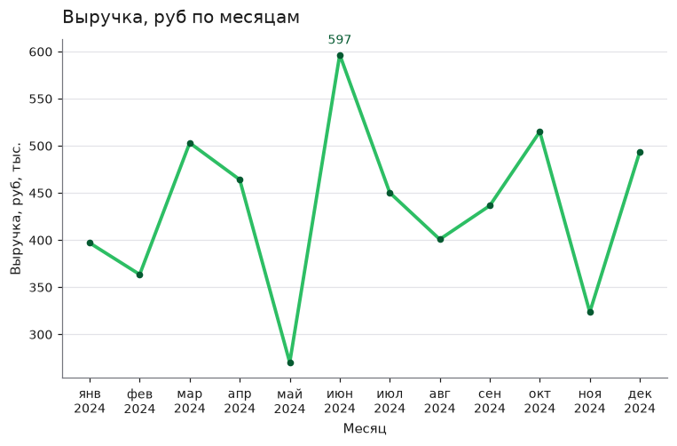
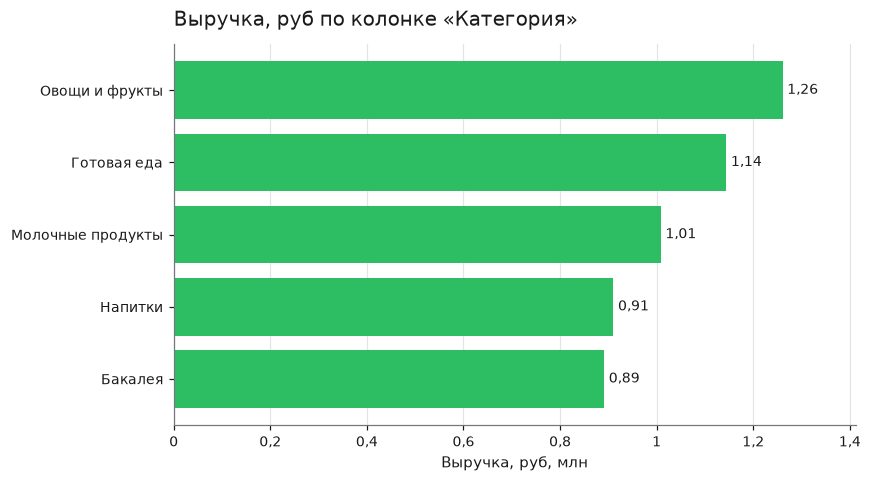
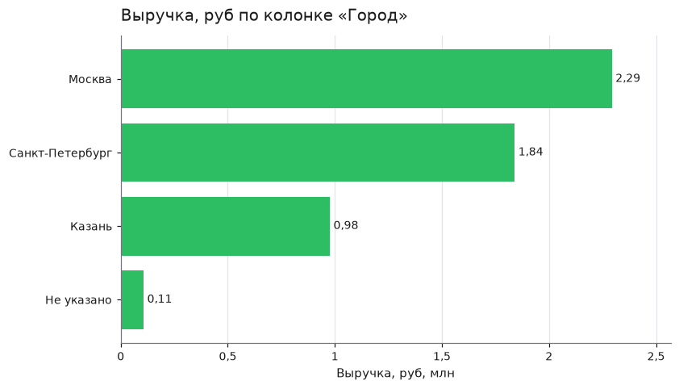
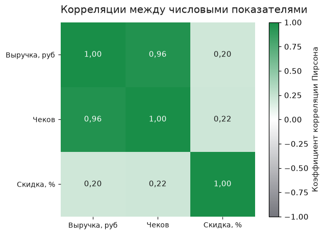

# Анализ продаж за 2024 год (orders_dirty.xlsx)

Источник данных: `orders_dirty.xlsx`. Строк в расчёте: 155. Дата отчёта: 2026-11-11.

## Что сделано с данными

- При чтении: прочитал лист «Выгрузка».
- При чтении: заголовок таблицы нашёл в строке 3, строки над ним пропустил: 2.
- При чтении: пропустил пустые строки: 2.
- При чтении: в колонке «Дата заказа» 31 значений были записаны текстом, прочитал их как даты.
- При чтении: в колонке «Выручка, руб» 23 значений были записаны текстом, прочитал их как числа.
- При очистке: привёл к одному написанию значения в колонке «Категория»: 10 строк (например, «бакалея» → «Бакалея»).
- При очистке: привёл к одному написанию значения в колонке «Город»: 9 строк (например, «казань» → «Казань»).
- При очистке: удалил полные дубликаты строк: 4.
- При очистке: заполнил пропуски в колонке «Чеков» медианой 35: 5.
- При очистке: заполнил пропуски в колонке «Город» значением «Не указано»: 3.
- При очистке: пометил строки с грубыми выбросами: 1. Они остались в таблице (колонка is_outlier), но в графики и итоги не входят.

## Графики

### Выручка, руб по месяцам

- Период: с янв 2024 по дек 2024, точек: 12.
- Сумма за период: 5 215 415.
- Максимум: июн 2024, 596 762.
- Минимум: май 2024, 270 210.

### Выручка, руб по колонке «Категория»

- Значений в колонке «Категория»: 5.
- Овощи и фрукты: 1 260 786 (24,2% от суммы).
- Готовая еда: 1 144 289 (21,9% от суммы).
- Молочные продукты: 1 008 544 (19,3% от суммы).
- Меньше всех: Бакалея, 891 328.

### Выручка, руб по колонке «Город»

- Значений в колонке «Город»: 4.
- Москва: 2 293 169 (44,0% от суммы).
- Санкт-Петербург: 1 839 570 (35,3% от суммы).
- Казань: 976 281 (18,7% от суммы).
- Меньше всех: Не указано, 106 395.

### Корреляции между числовыми показателями

- Строк в расчёте: 155.
- Выручка, руб и Чеков: +0,96 (сильная прямая связь).
- Чеков и Скидка, %: +0,22 (слабая прямая связь).
- Выручка, руб и Скидка, %: +0,20 (слабая прямая связь).
- Корреляция показывает, что величины меняются вместе. Причину она не доказывает.

## Выводы

1. Общая выручка за период с 4 января по 23 декабря 2024 года составила 5 215 415 руб. при 5 928 чеках; в расчёт вошли 155 строк из 156 (одна строка помечена как грубый выброс и исключена).
2. Средняя выручка в месяц — 434 618 руб. Лучший месяц — июнь 2024 (596 762 руб.), худший — май 2024 (270 210 руб.), то есть разрыв между максимумом и минимумом почти 2,2 раза.
3. Лидер по выручке — категория «Овощи и фрукты»: 1 260 786 руб. (24,2% суммы), далее «Готовая еда» — 1 144 289 руб. (21,9%) и «Молочные продукты» — 1 008 544 руб. (19,3%); замыкает список «Бакалея» — 891 328 руб. (17,1%).
4. География сконцентрирована: Москва даёт 2 293 169 руб. (44,0%), Санкт-Петербург — 1 839 570 руб. (35,3%), Казань — 976 281 руб. (18,7%); вместе Москва и Санкт-Петербург формируют 79,3% выручки.
5. По каналам продаж лидирует «Магазин» — 2 150 248 руб. (41,2%), «Доставка» — 1 914 507 руб. (36,7%), «Самовывоз» — 1 150 661 руб. (22,1%).
6. Динамика второй половины года к первой: рост показывают «Напитки» (+29,4%), «Овощи и фрукты» (+19,7%) и «Готовая еда» (+14,3%), а падение — «Бакалея» (-30,9%) и «Молочные продукты» (-21,0%).
7. По каналам во второй половине года выросли «Самовывоз» (+39,3%) и «Доставка» (+22,4%), тогда как «Магазин» снизился (-28,4%); среди городов вырос Санкт-Петербург (+34,1%), а Москва упала (-19,2%).
8. Выручка практически линейно связана с числом чеков: корреляция +0,96, тогда как связь выручки со скидкой слабая (+0,20) — размер скидки почти не объясняет объём продаж.

## Рекомендации

1. Сделать ставку на сильные категории: «Овощи и фрукты» и «Готовую еду» — вместе они дают 46,1% выручки и растут во второй половине года (+19,7% и +14,3%); расширить по ним ассортимент и полочное пространство.
2. Разобраться с падающими категориями: «Бакалея» (-30,9%) и «Молочные продукты» (-21,0%) во второй половине года теряют оборот — проверить цены, наличие и поставки, при необходимости пересмотреть закупки.
3. Перенести акцент на растущие каналы: «Самовывоз» (+39,3%) и «Доставка» (+22,4%) растут, а «Магазин» (-28,4%) снижается — развивать доставку и самовывоз, вкладываться в их продвижение.
4. Усилить работу в Санкт-Петербурге, который вырос на 34,1% и уже даёт 35,3% выручки, и отдельно проанализировать причины падения Москвы (-19,2%) при её доле 44,0%.
5. Использовать связь выручки с числом чеков (+0,96): наращивать трафик и частоту покупок (акции, программы лояльности), а не рассчитывать на скидки — их связь с выручкой слабая (+0,20).
6. Устранить пробелы в данных: 3 заказа без города (2,0% выручки, «Не указано») и 5 пропусков в «Чеков» — настроить обязательное заполнение полей, чтобы отчётность была полной.

## Как собран отчёт

Цифры и графики посчитал сервер. Выводы и рекомендации сформулировала языковая модель по этим цифрам. Строк, помеченных как выбросы и не вошедших в расчёт: 1.

## Приложение. Цифры, на которых стоят выводы

- источник: orders_dirty.xlsx
- строк в расчёте: 155
- главный показатель: Выручка, руб
- итоги:
  - Выручка, руб: 5215415
  - Чеков: 5928
- период:
  - начало: 2024-01-04
  - конец: 2024-12-23
- динамика по месяцам:
  - показатель: Выручка, руб
  - месяцев: 12
  - среднее за месяц: 434618
  - лучший месяц:
    - месяц: июнь 2024
    - значение: 596762
  - худший месяц:
    - месяц: май 2024
    - значение: 270210
- по категориям:
  - Категория:
    - показатель: Выручка, руб
    - значений: 5
    - суммы и доли:
      - Овощи и фрукты:
        - сумма: 1260786
        - доля процент: 24.2
      - Готовая еда:
        - сумма: 1144289
        - доля процент: 21.9
      - Молочные продукты:
        - сумма: 1008544
        - доля процент: 19.3
      - Напитки:
        - сумма: 910468
        - доля процент: 17.5
      - Бакалея:
        - сумма: 891328
        - доля процент: 17.1
    - вторая половина периода к первой процент:
      - Овощи и фрукты: 19.7
      - Готовая еда: 14.3
      - Молочные продукты: -21.0
      - Напитки: 29.4
      - Бакалея: -30.9
    - граница половин: 2024-06-29
  - Город:
    - показатель: Выручка, руб
    - значений: 4
    - суммы и доли:
      - Москва:
        - сумма: 2293169
        - доля процент: 44.0
      - Санкт-Петербург:
        - сумма: 1839570
        - доля процент: 35.3
      - Казань:
        - сумма: 976281
        - доля процент: 18.7
      - Не указано:
        - сумма: 106395
        - доля процент: 2.0
    - вторая половина периода к первой процент:
      - Москва: -19.2
      - Санкт-Петербург: 34.1
      - Казань: -0.5
      - Не указано: 7.9
    - граница половин: 2024-06-29
  - Канал:
    - показатель: Выручка, руб
    - значений: 3
    - суммы и доли:
      - Магазин:
        - сумма: 2150248
        - доля процент: 41.2
      - Доставка:
        - сумма: 1914507
        - доля процент: 36.7
      - Самовывоз:
        - сумма: 1150661
        - доля процент: 22.1
    - вторая половина периода к первой процент:
      - Магазин: -28.4
      - Доставка: 22.4
      - Самовывоз: 39.3
    - граница половин: 2024-06-29
- самые сильные связи:
  - Выручка, руб и Чеков: +0.96; Чеков и Скидка, %: +0.22; Выручка, руб и Скидка, %: +0.20
- качество данных:
  - что сделала очистка:
    - привёл к одному написанию значения в колонке «Категория»: 10 строк (например, «бакалея» → «Бакалея»); привёл к одному написанию значения в колонке «Город»: 9 строк (например, «казань» → «Казань»); удалил полные дубликаты строк: 4; заполнил пропуски в колонке «Чеков» медианой 35: 5; заполнил пропуски в колонке «Город» значением «Не указано»: 3; пометил строки с грубыми выбросами: 1. Они остались в таблице (колонка is_outlier), но в графики и итоги не входят
  - строк с выбросами вне расчёта: 1
