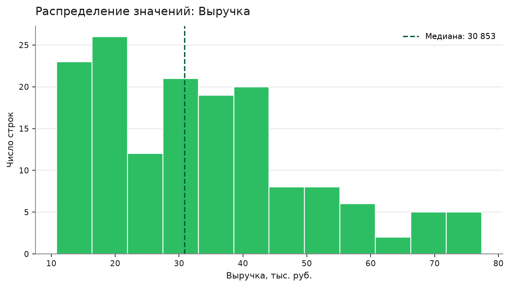
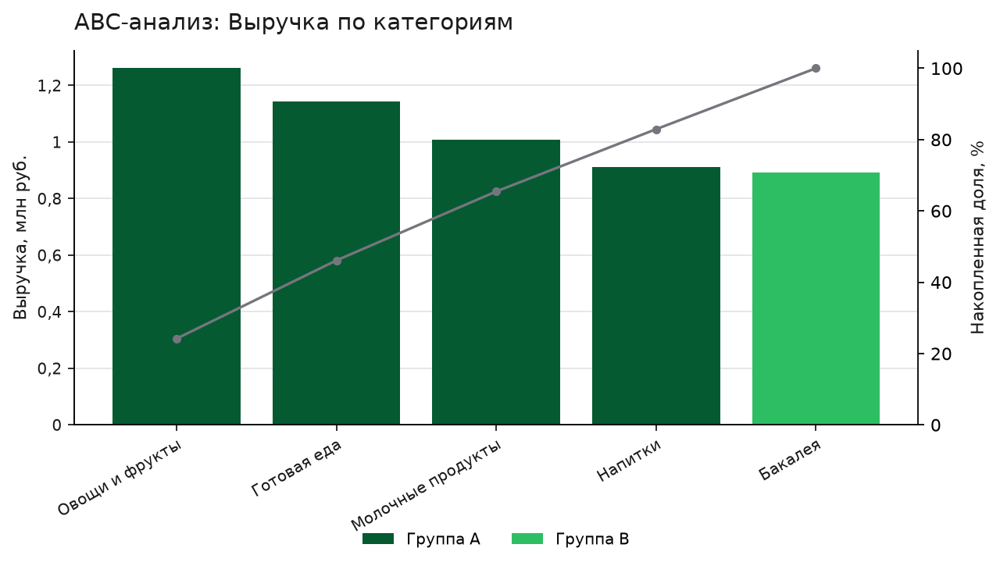

# Анализ продаж по заказам за 2024 год

orders_dirty.xlsx · 04.01.2024 – 23.12.2024 · 155 строк в расчёте · отчёт от 11.11.2026

## Главное

- Выручка, руб.: 5 215 415
- Чеков: 5 928
- Среднее за месяц, руб.: 434 618
- Период: 12 месяцев

## Выводы

1. **Выручка держится около 435 тысяч рублей в месяц.** За 2024 год выручка составила 5 215 415 руб, в среднем 434 618 руб в месяц. Лучший месяц июнь 2024 с 596 762 руб, худший май 2024 с 270 210 руб.
2. **Продажи сосредоточены в Москве и Санкт-Петербурге.** Москва дала 2 293 169 руб, или 44,0% выручки, Санкт-Петербург 1 839 570 руб, или 35,3%. На Казань приходится 18,7%.
3. **Овощи и фрукты лидируют по выручке.** Категория принесла 1 260 786 руб, это 24,2% суммы. В группу A ABC-анализа вошли 4 категории, дающие 82,9% выручки.
4. **Доставка и самовывоз растут, магазин падает.** Во второй половине периода доставка выросла на 22,4%, самовывоз на 39,3%, а продажи через магазин упали на 28,4%.
5. **Выручка растёт вместе с числом чеков.** Корреляция выручки и чеков составляет +0,96. Всего за период 5 928 чеков. Связь со скидкой слабая: +0,20.

## Рекомендации

1. **Перенести акцент на доставку и самовывоз.** Доставка выросла на 22,4%, самовывоз на 39,3%, а магазин упал на 28,4% во второй половине периода.
2. **Разобраться с падением бакалеи и молочных продуктов.** Бакалея снизилась на 30,9%, молочные продукты на 21,0% во второй половине периода.
3. **Восстановить продажи в Москве.** Крупнейший город дал 44,0% выручки, но вторая половина периода к первой показала падение на 19,2%.
4. **Поддерживать ассортимент категорий группы A.** Овощи и фрукты, готовая еда, молочные продукты и напитки вместе дают 82,9% выручки.

## Графики

### Выручка по месяцам

Сумма за период: 5 215 415. Максимум: июн 2024, 596 762. Минимум: май 2024, 270 210.

### Выручка по категориям

Овощи и фрукты: 1 260 786 (24,2% от суммы). Готовая еда: 1 144 289 (21,9% от суммы). Молочные продукты: 1 008 544 (19,3% от суммы). Меньше всех: Бакалея, 891 328.

### Выручка по городам

Москва: 2 293 169 (44,0% от суммы). Санкт-Петербург: 1 839 570 (35,3% от суммы). Казань: 976 281 (18,7% от суммы). Меньше всех: Не указано, 106 395.

### Корреляции между числовыми показателями

Выручка и Чеков: +0,96 (сильная прямая связь). Чеков и Скидка: +0,22 (слабая прямая связь). Выручка и Скидка: +0,20 (слабая прямая связь). Корреляция показывает, что величины меняются вместе. Причину она не доказывает.

### Распределение значений: Выручка

Медиана: 30 853, среднее: 33 648. Минимум: 10 827, максимум: 77 380.

### ABC-анализ: Выручка по категориям

Группа A (4 значения, 82,9% суммы): Овощи и фрукты, Готовая еда, Молочные продукты, Напитки. Группа B (1 значение, 17,1% суммы): Бакалея.

## Что сделано с данными

### При чтении файла

- Прочитал лист «Выгрузка».
- Заголовок таблицы нашёл в строке 3, строки над ним пропустил: 2.
- Пропустил пустые строки: 2.
- В колонке «Дата заказа» значения были записаны текстом: 31, прочитал их как даты.
- В колонке «Выручка» значения были записаны текстом: 23, прочитал их как числа.

### При очистке

- Привёл к одному написанию значения в колонке «Категория»: 10 строк (например, «бакалея» → «Бакалея»).
- Привёл к одному написанию значения в колонке «Город»: 9 строк (например, «казань» → «Казань»).
- Удалил полные дубликаты строк: 4.
- Заполнил пропуски в колонке «Чеков» медианой 35: 5.
- Заполнил пропуски в колонке «Город» значением «Не указано»: 3.
- Пометил строки с грубыми выбросами: 1. Они остались в таблице (колонка is_outlier), но в графики и итоги не входят.

Как собран отчёт. Цифры и графики посчитал сервер. Выводы и рекомендации сформулировала языковая модель по этим цифрам. Строк, помеченных как выбросы и не вошедших в расчёт: 1.

## Приложение. Цифры, на которых стоят выводы

- источник: orders_dirty.xlsx
- строк в расчёте: 155
- главный показатель: Выручка
- итоги:
  - Выручка: 5 215 415
  - Чеков: 5 928
- период:
  - начало: 04.01.2024
  - конец: 23.12.2024
- динамика по месяцам:
  - показатель: Выручка
  - месяцев: 12
  - среднее за месяц: 434 618
  - лучший месяц:
    - месяц: июнь 2024
    - значение: 596 762
  - худший месяц:
    - месяц: май 2024
    - значение: 270 210
- по категориям:
  - Категория:
    - показатель: Выручка
    - значений: 5
    - суммы и доли:
      - Овощи и фрукты:
        - сумма: 1 260 786
        - доля процент: 24,2
      - Готовая еда:
        - сумма: 1 144 289
        - доля процент: 21,9
      - Молочные продукты:
        - сумма: 1 008 544
        - доля процент: 19,3
      - Напитки:
        - сумма: 910 468
        - доля процент: 17,5
      - Бакалея:
        - сумма: 891 328
        - доля процент: 17,1
    - вторая половина периода к первой процент:
      - Овощи и фрукты: 19,7
      - Готовая еда: 14,3
      - Молочные продукты: −21
      - Напитки: 29,4
      - Бакалея: −30,9
    - граница половин: 29.06.2024
  - Город:
    - показатель: Выручка
    - значений: 4
    - суммы и доли:
      - Москва:
        - сумма: 2 293 169
        - доля процент: 44
      - Санкт-Петербург:
        - сумма: 1 839 570
        - доля процент: 35,3
      - Казань:
        - сумма: 976 281
        - доля процент: 18,7
      - Не указано:
        - сумма: 106 395
        - доля процент: 2
    - вторая половина периода к первой процент:
      - Москва: −19,2
      - Санкт-Петербург: 34,1
      - Казань: −0,5
      - Не указано: 7,9
    - граница половин: 29.06.2024
  - Канал:
    - показатель: Выручка
    - значений: 3
    - суммы и доли:
      - Магазин:
        - сумма: 2 150 248
        - доля процент: 41,2
      - Доставка:
        - сумма: 1 914 507
        - доля процент: 36,7
      - Самовывоз:
        - сумма: 1 150 661
        - доля процент: 22,1
    - вторая половина периода к первой процент:
      - Магазин: −28,4
      - Доставка: 22,4
      - Самовывоз: 39,3
    - граница половин: 29.06.2024
- самые сильные связи:
  - Выручка и Чеков: +0,96; Чеков и Скидка: +0,22; Выручка и Скидка: +0,20
- качество данных:
  - что сделала очистка:
    - привёл к одному написанию значения в колонке «Категория»: 10 строк (например, «бакалея» → «Бакалея»); привёл к одному написанию значения в колонке «Город»: 9 строк (например, «казань» → «Казань»); удалил полные дубликаты строк: 4; заполнил пропуски в колонке «Чеков» медианой 35: 5; заполнил пропуски в колонке «Город» значением «Не указано»: 3; пометил строки с грубыми выбросами: 1. Они остались в таблице (колонка is_outlier), но в графики и итоги не входят
  - строк с выбросами вне расчёта: 1
