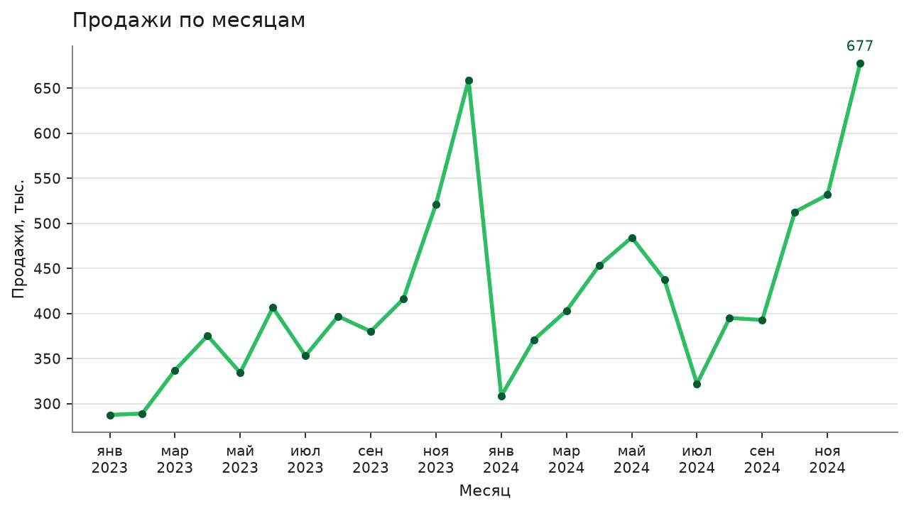
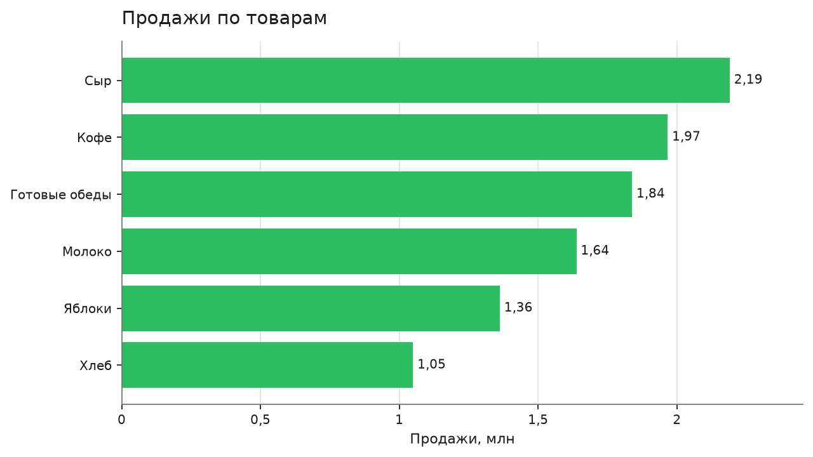
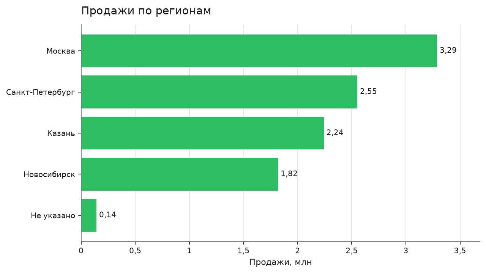
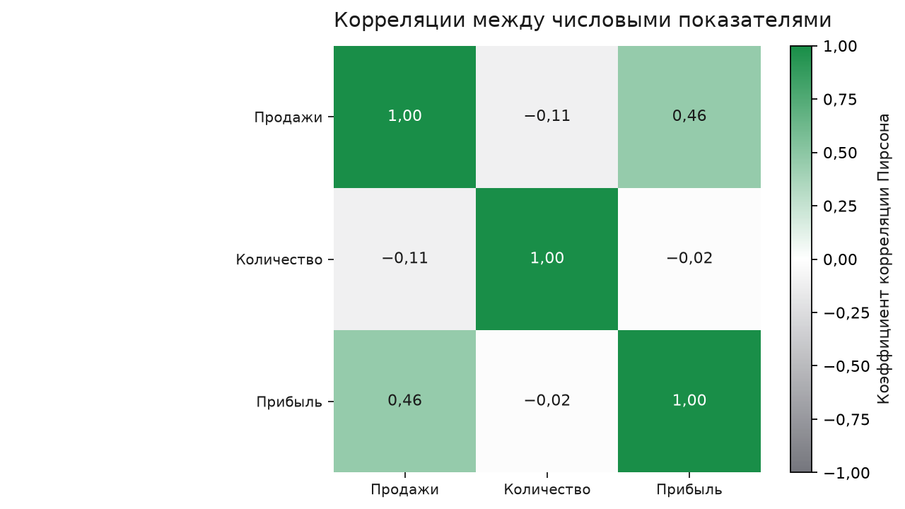

# Анализ продаж за 2023–2024

sales_data.csv · 01.01.2023 – 25.12.2024 · 190 строк в расчёте · отчёт от 11.11.2026

## Главное

- Продажи: 10 046 660
- Прибыль: 1 776 705
- Маржа: 17,7%
- Период: 24 месяца

## Выводы

1. **Готовые обеды продаются в убыток.** Маржа −6,9% и убыток 126 415 при выручке 1 838 630, это 18,3% всех продаж.
2. **Продажи растут двузначными темпами.** 2024 год дал 5 289 860 против 4 756 800 в 2023, рост 11,2%; средний месяц 418 611.
3. **Ноябрь и декабрь дают пик продаж.** Декабрь 1,6 от среднего месяца и ноябрь 1,26, а январь слабейший с 0,71 и февраль 0,79.
4. **Москва приносит треть выручки.** 3 288 920 или 32,7% продаж при марже 17,8%, близкой к средней 17,7%.
5. **Кофе самый маржинальный товар.** Маржа Кофе 30,2% при выручке 1 967 060 (19,6%); Сыр лидирует по выручке 2 190 560 с маржой 22,0%.

## Рекомендации

1. **Пересчитать цену и закупку готовых обедов.** Убыток 126 415 и маржа −6,9% при доле 18,3% выручки; цена не покрывает себестоимость.
2. **Усилить запасы и промо к ноябрю и декабрю.** Декабрь 1,6 и ноябрь 1,26 от среднего месяца против 0,71 в январе и 0,79 в феврале.
3. **Развивать Казань и молочную группу.** Казань +46,5% и Молоко +40,1% во второй половине периода к первой.
4. **Проверить Новосибирск и регион «Не указано».** Новосибирск −2,0% во второй половине периода, у «Не указано» маржа 8,9% против 17,7% в среднем.

## Графики

### Продажи по месяцам

Сумма за период: 10 046 660. Максимум: дек 2024, 677 470. Минимум: янв 2023, 287 540.

### Продажи по товарам

Сыр: 2 190 560 (21,8% от суммы). Кофе: 1 967 060 (19,6% от суммы). Готовые обеды: 1 838 630 (18,3% от суммы). Меньше всех: Хлеб, 1 049 870.

### Продажи по регионам

Москва: 3 288 920 (32,7% от суммы). Санкт-Петербург: 2 552 190 (25,4% от суммы). Казань: 2 242 690 (22,3% от суммы). Меньше всех: Не указано, 142 970.

### Корреляции между числовыми показателями

Продажи и Прибыль: +0,46 (заметная прямая связь). Продажи и Количество: −0,11 (слабая обратная связь). Количество и Прибыль: −0,02 (слабая обратная связь). Корреляция показывает, что величины меняются вместе. Причину она не доказывает.

## Что сделано с данными

### При чтении файла

- Разделитель «,», кодировка UTF-8.

### При очистке

- Удалил полные дубликаты строк: 3.
- Заполнил пропуски в колонке «Количество» медианой 210,5: 4.
- Заполнил пропуски в колонке «Прибыль» медианой 9 616: 3.
- Заполнил пропуски в колонке «Регион» значением «Не указано»: 2.
- Пометил строки с грубыми выбросами: 2. Они остались в таблице (колонка is_outlier), но в графики и итоги не входят.

Как собран отчёт. Цифры и графики посчитал сервер. Выводы и рекомендации сформулировала языковая модель по этим цифрам. Строк, помеченных как выбросы и не вошедших в расчёт: 2.

## Приложение. Цифры, на которых стоят выводы

- источник: sales_data.csv
- строк в расчёте: 190
- главный показатель: Продажи
- итоги:
  - Продажи: 10 046 660
  - Количество: 54 970
  - Прибыль: 1 776 705
- маржа процент: 17,7
- период:
  - начало: 01.01.2023
  - конец: 25.12.2024
- динамика по месяцам:
  - показатель: Продажи
  - месяцев: 24
  - среднее за месяц: 418 611
  - лучший месяц:
    - месяц: декабрь 2024
    - значение: 677 470
  - худший месяц:
    - месяц: январь 2023
    - значение: 287 540
- сезонность:
  - как считается: среднее значение месяца, делённое на среднее по всем месяцам; 1,0 это обычный месяц
  - самые сильные месяцы:
    - декабрь: 1,6
    - ноябрь: 1,26
  - самые слабые месяцы:
    - февраль: 0,79
    - январь: 0,71
- по годам:
  - суммы:
    - 2023: 4 756 800
    - 2024: 5 289 860
  - последний год к предыдущему процент: 11,2
  - месяцев с данными:
    - 2023: 12
    - 2024: 12
- по категориям:
  - Товар:
    - показатель: Продажи
    - значений: 6
    - суммы и доли:
      - Сыр:
        - сумма: 2 190 560
        - доля процент: 21,8
      - Кофе:
        - сумма: 1 967 060
        - доля процент: 19,6
      - Готовые обеды:
        - сумма: 1 838 630
        - доля процент: 18,3
      - Молоко:
        - сумма: 1 638 310
        - доля процент: 16,3
      - Яблоки:
        - сумма: 1 362 230
        - доля процент: 13,6
      - Хлеб:
        - сумма: 1 049 870
        - доля процент: 10,4
    - маржа процент:
      - Сыр: 22
      - Кофе: 30,2
      - Готовые обеды: −6,9
      - Молоко: 18,4
      - Яблоки: 19,7
      - Хлеб: 24,6
    - отрицательная прибыль:
      - Готовые обеды: −126 415
    - вторая половина периода к первой процент:
      - Сыр: 20,4
      - Кофе: 15,5
      - Готовые обеды: 12,1
      - Молоко: 40,1
      - Яблоки: 30,4
      - Хлеб: 3,2
    - граница половин: 29.12.2023
  - Регион:
    - показатель: Продажи
    - значений: 5
    - суммы и доли:
      - Москва:
        - сумма: 3 288 920
        - доля процент: 32,7
      - Санкт-Петербург:
        - сумма: 2 552 190
        - доля процент: 25,4
      - Казань:
        - сумма: 2 242 690
        - доля процент: 22,3
      - Новосибирск:
        - сумма: 1 819 890
        - доля процент: 18,1
      - Не указано:
        - сумма: 142 970
        - доля процент: 1,4
    - маржа процент:
      - Москва: 17,8
      - Санкт-Петербург: 17,9
      - Казань: 18,1
      - Новосибирск: 17,4
      - Не указано: 8,9
    - вторая половина периода к первой процент:
      - Москва: 20,5
      - Санкт-Петербург: 5,2
      - Казань: 46,5
      - Новосибирск: −2
      - Не указано: нет данных
    - граница половин: 29.12.2023
- самые сильные связи:
  - Продажи и Прибыль: +0,46; Продажи и Количество: −0,11; Количество и Прибыль: −0,02
- качество данных:
  - что сделала очистка:
    - удалил полные дубликаты строк: 3; заполнил пропуски в колонке «Количество» медианой 210,5: 4; заполнил пропуски в колонке «Прибыль» медианой 9 616: 3; заполнил пропуски в колонке «Регион» значением «Не указано»: 2; пометил строки с грубыми выбросами: 2. Они остались в таблице (колонка is_outlier), но в графики и итоги не входят
  - строк с выбросами вне расчёта: 2
